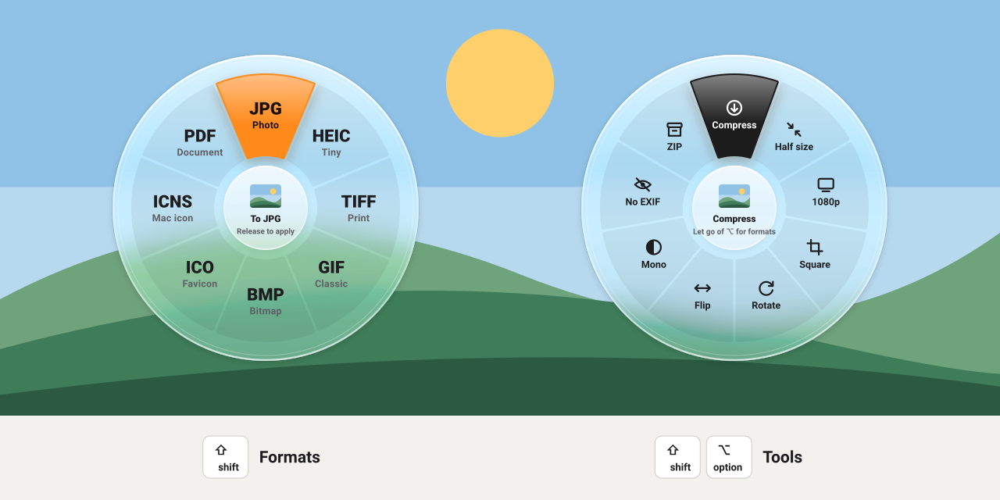

<p align="center">
  
</p>

<h1 align="center">Convmog <sub>by Jericho</sub></h1>

<p align="center">
  Hold <kbd>⇧</kbd> while dragging any file and drop it on a format.<br>
  The converted file lands next to the original — made on your Mac, never uploaded.
</p>

<p align="center">
  <picture>
    <source media="(max-width: 600px)" srcset="assets/demo-phone.svg">
    
  </picture>
</p>

## Install

Paste this into Terminal:

```bash
curl -fsSL https://raw.githubusercontent.com/MSreeGaneshNaik/convmog/main/install.sh | bash
```

It downloads the source, builds Convmog on your Mac with Apple's own Swift compiler, puts it in Applications and opens it. About a minute, no account, no dependencies. Look for the petal mark in the menu bar and choose **Open at Login** to keep it running.

Convmog needs macOS 13 or later and Apple's Command Line Tools. If they're missing, the installer opens Apple's installer for you — run the same line again when it finishes.

## How it works

| You | Convmog |
|---|---|
| Drag a file and hold <kbd>⇧</kbd> | A wheel blooms around the cursor with only the formats this file can become |
| Move over a wedge | It lifts toward you, the trackpad ticks, and the centre names the action |
| Add <kbd>⌥</kbd> | The wheel swaps to tools: compress, resize, rotate, strip metadata and more |
| Let go on a wedge | The result is saved beside the original and a pill shows the size before and after |
| Let go anywhere else | Nothing happens — it was an ordinary drag |
| Click the pill | Finder opens with the new file selected |

<p align="center">
  <picture>
    <source media="(max-width: 600px)" srcset="assets/modes-phone.svg">
    
  </picture>
</p>

## Everything in the wheel

| Drag | <kbd>⇧</kbd> Formats | <kbd>⇧</kbd> <kbd>⌥</kbd> Tools |
|---|---|---|
| **Images** — HEIC, PNG, JPG, RAW, PSD, WebP, TIFF… | JPG, PNG, HEIC, TIFF, GIF, BMP, ICO, ICNS, PDF | Compress, Half size, 1080p, Square, Rotate, Flip, Mono, No EXIF, ZIP |
| **PDF** | PNG pages, JPG pages, DOCX, RTF, TXT | Compress, Merge, Split, Rotate, OCR, Cover, Clean, ZIP |
| **Video** — MP4, MOV, M4V | MP4, MOV, M4V, GIF, M4A, WAV | 720p, HEVC, 540p, Mute, Frame, Clean, Join, ZIP |
| **Audio** — MP3, M4A, WAV, AIFF, FLAC | M4A, WAV, AIFF, FLAC | Compress, Mono, Ringtone, Join, ZIP |
| **Documents** — DOCX, RTF, HTML, ODT, TXT, Markdown | PDF, DOCX, TXT, RTF, HTML, ODT, DOC | Merge, ZIP |
| **Archives** — ZIP, TAR.GZ, 7Z, RAR | Extract | — |
| **Several images and PDFs together** | — | Merge into one PDF, ZIP |
| **Anything else, including folders** | — | ZIP |

Drag several files of the same kind and the action runs on each one; Merge and Join combine them in the order you dragged them.

## Private by design

Every conversion runs on your Mac with frameworks Apple ships — ImageIO, PDFKit, AVFoundation and Core Image — plus the built-in `afconvert`, `textutil`, `ditto`, `zip` and `tar`. Convmog contains no network code. It never overwrites anything: if `photo.heic` exists, you get `photo 2.heic`.

## More formats with ffmpeg

```bash
brew install ffmpeg
```

Convmog picks it up on its own, no restart needed. Videos gain MP3, WebM, MKV and AVI; audio gains MP3, OGG, Opus and a Normalize tool; images gain WebP output where macOS can't write it; and MKV, WebM, AVI, OGG and Opus files become things you can drag in.

## Uninstall

```bash
pkill -x Convmog
rm -rf /Applications/Convmog.app
```

## Build from source

```bash
git clone https://github.com/MSreeGaneshNaik/convmog.git
cd convmog
./build.sh             # build and launch from ./build
./build.sh --install   # or install into /Applications
./build.sh --check     # build and self-test only, as CI does on every push
```

There is no Xcode project — just `swiftc` and about 2,200 lines of Swift.

| File | What it does |
|---|---|
| [`Sources/App.swift`](Sources/App.swift) | Entry point, menu bar, colour palette and the spring helpers |
| [`Sources/DragWatcher.swift`](Sources/DragWatcher.swift) | Notices a ⇧-drag anywhere on the Mac, with no special permissions |
| [`Sources/Wheel.swift`](Sources/Wheel.swift) | The wheel: material disc, wedges, hover, and the drop itself |
| [`Sources/HUD.swift`](Sources/HUD.swift) | The status pill at the bottom of the screen |
| [`Sources/Catalog.swift`](Sources/Catalog.swift) | Which wedges each kind of file gets |
| [`Sources/Engine.swift`](Sources/Engine.swift) | Every conversion and tool |
| [`Sources/SelfTest.swift`](Sources/SelfTest.swift) | Checks the wedge maths, file naming and file kinds; `build.sh` runs it and won't launch a build that fails |

## Good to know

- The first time you convert something on the Desktop or in Documents or Downloads, macOS asks Convmog for access to that folder. Allow it so Convmog can save next to your files.
- With **Reduce Motion** on, the springs become gentle cross-fades.
- `build.sh` signs the app locally. Rebuilding gives it a new signature, so macOS may ask for folder access again.

## Credits

Convmog is made by Jericho, and the petal mark is Jericho's. The ⇧-drag radial gesture was inspired by Tangerine, a Mac app by Leap Studio. Convmog is an independent, from-scratch implementation.
